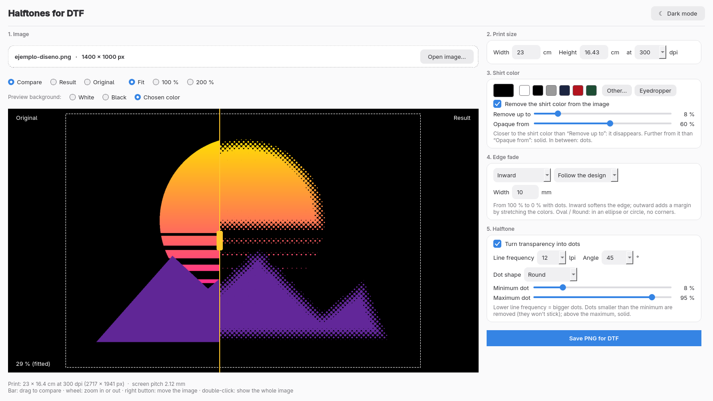

# Semitonos DTF

Prepare images for **DTF** (direct-to-film) printing with halftones.

DTF white ink needs every pixel to be either fully opaque or fully transparent. Semitonos DTF takes an image,
removes the shirt color from it, fades the edges inward or outward, and turns the transparency into a halftone of dots,
with a live before/after preview on any shirt color.



## Features
- Remove the shirt color (with eyedropper) so it prints as transparency.
- Edge fade: inward or outward, following the design, oval or round.
- Halftone with adjustable line frequency (lpi), angle, dot shape (round, Euclidean, square, lines) and minimum/maximum dot.
- Live comparison of original and result, zoom, and light/dark interface.
- Saves a PNG with the print resolution (dpi) you chose. Nothing is ever overwritten.
- Interface in **Spanish, English, German, Italian, French, Brazilian Portuguese and Catalan** (follows the system language).

## Install
Packaged as a Flatpak: `com.tiasmile.SemitonosDTF`. Download the `.flatpak` file from the
[Releases](../../releases) page and install it with:

```
flatpak install --user semitonos-dtf-1.0.0.flatpak
```

(The KDE 6.11 runtime is downloaded from Flathub if you don't have it.)

## Run from source
Needs Python 3, PySide6, Pillow and NumPy.
```
cd codigo
python3 semitonos.py [image.png]
```

## Languages and translating
Translations are AI-assisted and **not yet reviewed by native speakers**; corrections are welcome. See [TRADUCIR.md](TRADUCIR.md).
See also [AI-ASSISTANCE.md](AI-ASSISTANCE.md).

## License
GNU Affero General Public License v3.0 or later. See [LICENSE](LICENSE).

[Leer en castellano](README.es.md)
